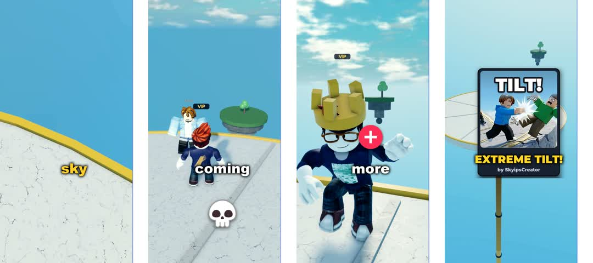

# Roblox Shorts Automation

The pipeline that markets my Roblox games: it records gameplay, writes and voices a short video, renders it to 9:16 with subtitles, and posts it to TikTok, YouTube Shorts and Instagram Reels on a daily schedule.

## The steps
1. **Record.** A scripted "pilot" plays the game in Roblox Studio and logs events (pushes, knock-outs, wins) with timestamps.
2. **Voice-over.** The script is voiced with a local Kokoro TTS voice clone (`tilt5_vo.py`). faster-whisper then transcribes the result to check that every word came out right.
3. **Edit.** `reel_copy.py` cuts shots to the timing of the voice-over words (zooms, whips, flashes), crops to 1080x1920, adds an end card, and normalises loudness to -16 LUFS (`sap5_finish.py`).
4. **Post.** `post_queue.py` and `post_daily.py` post one video per game per day. They use a YouTube rota so the channel gets at most 1 Short a day (posting more got the channel throttled).
5. **Measure.** `analytics.py` pulls views per post so I can make more of what works.
6. **Ship the game.** `push_places.py` publishes the place files through the Roblox Open Cloud API.

## Ads experiments (real numbers)
- **Everybody Has a Secret:** $15.16 spent, 293 clicks, 2.3% CTR, but only about 81 players actually joined (about 19 cents per player).
- **Extreme Tilt:** a 3-thumbnail test (the method is to run 3 styles and keep the best). The first round hit 2.0%. I then replaced the weakest images with new ones in the winner's style, and one of the new ones reached 4.1% early on.

## Notes
- Paths are relative. Secrets are read from files that are not in this repo.
- These are working scripts from a real project, not a polished library.

## How this was built
I designed, directed, play-tested and shipped this project. Most of the code was written with an AI coding agent (Claude, running in the Hermes agent framework) working from my specs and bug reports, and I decided what to build, what to change and when to ship. Knowing how to use an AI agent to get from an idea to a live, tested product is the skill this repo shows.
